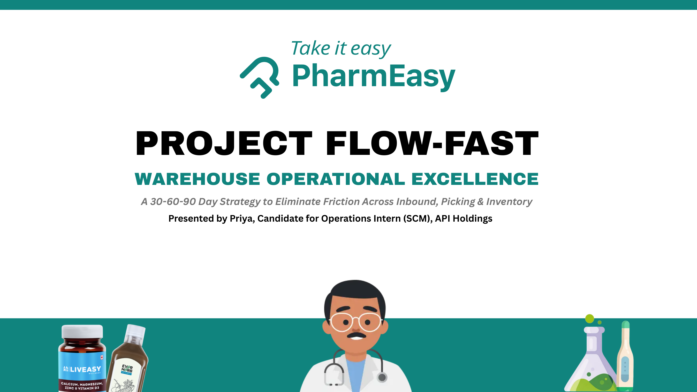
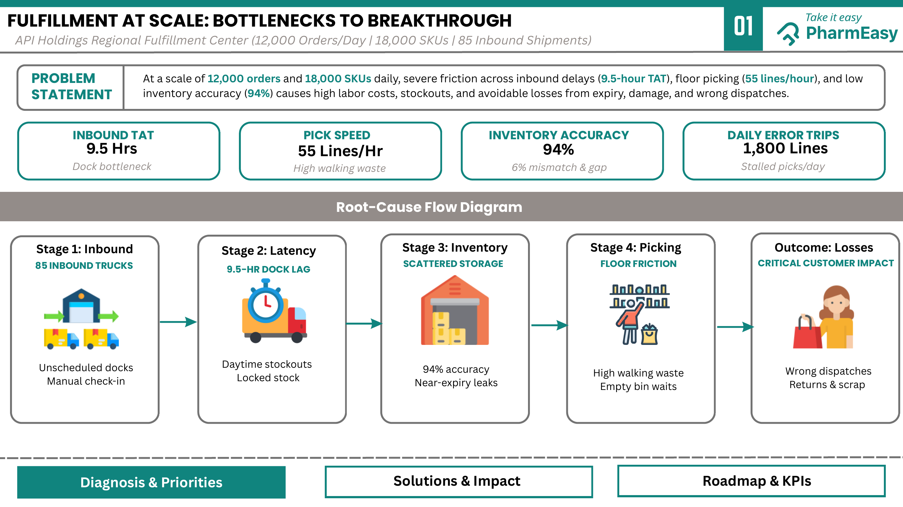
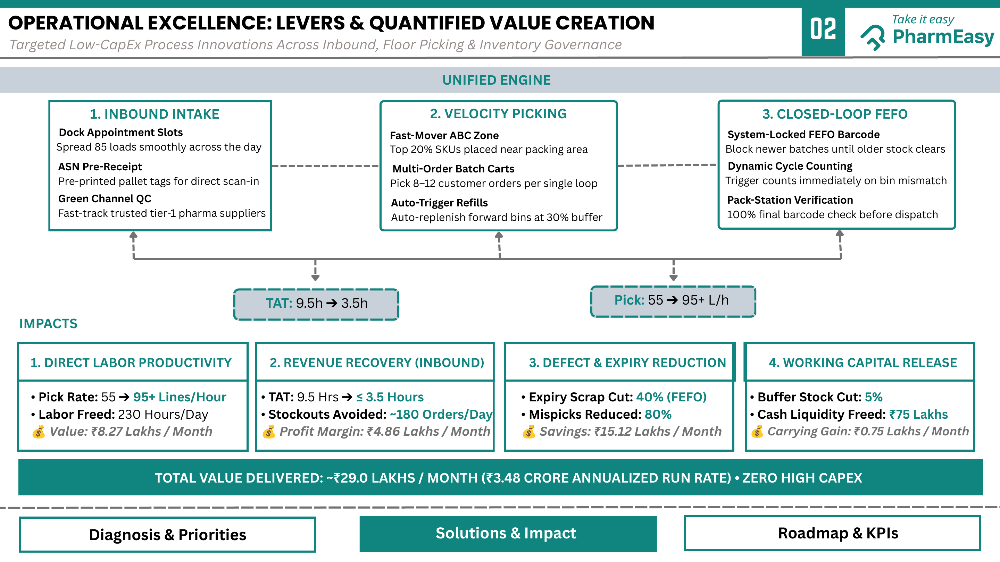
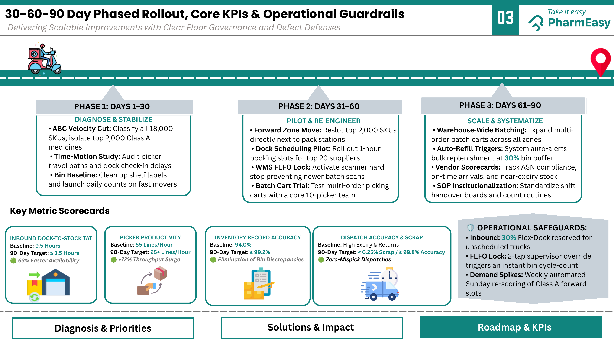

# 🚚 Project Flow-Fast: Warehouse Operational Excellence

**A 30-60-90 Day Strategy to Eliminate Friction Across Inbound, Picking & Inventory**

> **Case study submitted by Priya** as a candidate for the **Operations Intern (SCM)** role at **API Holdings**.

---

> ### ⚠️ Disclaimer
> This repository is a **candidate case study / assignment**. It is an analytical exercise with **proposed recommendations only**. I have not worked at API Holdings or PharmEasy, and nothing here has been implemented in a real warehouse. The operating metrics, the cost assumptions, and the projected savings are **case-study inputs and estimates** used to demonstrate structured problem-solving, not audited company data. The PharmEasy / API Holdings branding appears only because the case was framed around that business.

---

## 📑 Table of Contents

1. [Project Overview](#-project-overview)
2. [Business / Problem Statement](#-business--problem-statement)
3. [Current Operational Metrics](#-current-operational-metrics-baseline)
4. [Key Bottlenecks Identified](#-key-bottlenecks-identified)
5. [Proposed Solutions](#-proposed-solutions-the-unified-engine)
6. [Quantified Impact & Projected Value](#-quantified-impact--projected-value)
7. [30-60-90 Day Implementation Roadmap](#-30-60-90-day-proposed-implementation-roadmap)
8. [KPI Scorecard](#-kpi-scorecard)
9. [Operational Safeguards](#-proposed-operational-safeguards)
10. [Project Preview](#-project-preview)
11. [Key Supply-Chain Concepts Used](#-key-supply-chain-concepts-used)
12. [Project Learning / Conclusion](#-project-learning--conclusion)
13. [Repository Structure](#-repository-structure)
14. [Author](#-author)

---

## 📌 Project Overview

**Project Flow-Fast** analyses a high-volume regional fulfillment center and proposes a **low-CapEx, process-led improvement plan** across three connected areas of warehouse operations:

| Focus Area | Core Idea |
|---|---|
| **Inbound** | Smooth out dock congestion and speed up dock-to-stock availability |
| **Picking** | Reduce walking waste and stalled picks on the floor |
| **Inventory** | Raise record accuracy and enforce FEFO to cut expiry and wrong dispatches |

**Case setting:** API Holdings Regional Fulfillment Center

| Scale Parameter | Value |
|---|---|
| Daily orders | 12,000 |
| Active SKUs | 18,000 |
| Inbound shipments | 85 |

The deliverable is a 3-part strategy deck (Diagnosis → Solutions & Impact → Roadmap & KPIs) plus an appendix showing the full calculation logic behind every projected number.

---

## 🎯 Business / Problem Statement

At a scale of **12,000 orders** and **18,000 SKUs** daily, severe friction across **inbound delays (9.5-hour TAT)**, **floor picking (55 lines/hour)**, and **low inventory accuracy (94%)** causes **high labor costs, stockouts, and avoidable losses** from expiry, damage, and wrong dispatches.

---

## 📊 Current Operational Metrics (Baseline)

| Metric | Baseline | Observation |
|---|---|---|
| **Inbound TAT** (dock-to-stock) | **9.5 hours** | Dock bottleneck |
| **Pick Speed** | **55 lines/hour** | High walking waste |
| **Inventory Record Accuracy** | **94%** | 6% mismatch & gap |
| **Daily Error Trips** | **1,800 lines** | Stalled picks per day |

**Additional baseline figures used in the appendix calculations:**

| Metric | Baseline |
|---|---|
| Direct labor hours needed | ~545 hours/day |
| Expiry & scrap loss | ~1.0% of inventory |
| Order mispicks & wrong dispatches | ~1.5% of orders |
| Buffer safety stock | 100% (baseline) |

---

## 🔍 Key Bottlenecks Identified

The case traces how friction compounds across five stages, from the dock to the customer:

| Stage | Issue | Symptoms |
|---|---|---|
| **1. Inbound** | 85 inbound trucks arrive without a schedule | Unscheduled docks, manual check-in |
| **2. Latency** | 9.5-hour dock lag | Daytime stockouts, locked stock |
| **3. Inventory** | Scattered storage | 94% accuracy, near-expiry leaks |
| **4. Picking** | Floor friction | High walking waste, empty-bin waits |
| **Outcome** | Losses and customer impact | Wrong dispatches, returns & scrap |

**Root-cause chain:** *Unscheduled inbound → long dock lag → stock not available when needed → scattered, inaccurate inventory → wasted picker effort → wrong dispatches, returns and scrap.*

---

## 💡 Proposed Solutions: The "Unified Engine"

The proposal bundles three levers into one system. All of them are **process innovations with zero high CapEx**.

### 1️⃣ Inbound Optimization: *Inbound Intake*

| Proposed Lever | How It Works |
|---|---|
| **Dock Appointment Slots** | Spread the 85 loads smoothly across the day |
| **ASN Pre-Receipt** | Pre-printed pallet tags enable direct scan-in |
| **Green Channel QC** | Fast-track trusted tier-1 pharma suppliers |

🎯 **Target:** Inbound dock-to-stock TAT from **9.5h → 3.5h**

### 2️⃣ Picking Optimization: *Velocity Picking*

| Proposed Lever | How It Works |
|---|---|
| **Fast-Mover ABC Zone** | Place the top 20% of SKUs near the packing area |
| **Multi-Order Batch Carts** | Pick 8–12 customer orders in a single loop |
| **Auto-Trigger Refills** | Auto-replenish forward bins at a 30% buffer |

🎯 **Target:** Pick rate from **55 → 95+ lines/hour**

### 3️⃣ Inventory / FEFO Optimization: *Closed-Loop FEFO*

| Proposed Lever | How It Works |
|---|---|
| **System-Locked FEFO Barcode** | Block newer batches until older stock clears |
| **Dynamic Cycle Counting** | Trigger counts immediately on a bin mismatch |
| **Pack-Station Verification** | 100% final barcode check before dispatch |

🎯 **Target:** Inventory record accuracy from **94% → ≥ 99.2%**

---

## 💰 Quantified Impact & Projected Value

> All values below are **projected estimates** derived from the case assumptions. The full step-by-step logic is in the [Appendix pages of the PDF](Priya_Assignment.pdf).

| # | Impact Area | Key Change | Projected Value |
|---|---|---|---|
| 1 | **Direct Labor Productivity** | Pick rate 55 → 95+ lines/hr; **230 labor hours/day** freed | **₹8.27 lakh / month** |
| 2 | **Revenue Recovery (Inbound)** | TAT 9.5h → ≤ 3.5h; **~180 orders/day** of stockouts avoided | **₹4.86 lakh / month** (contribution margin) |
| 3 | **Defect & Expiry Reduction** | Expiry scrap cut **40%** (FEFO); mispicks reduced **80%** | **₹15.12 lakh / month** |
| 4 | **Working Capital Release** | Buffer stock cut **5%**; **₹75 lakh** cash liquidity freed | **₹0.75 lakh / month** (carrying gain) |

### 🏁 Total Projected Value: **~₹29.0 lakh / month** (**₹3.48 crore annualized run rate**), with **zero high CapEx**

### 🧮 Calculation Logic (from the Appendix)

<details>
<summary><b>1. Direct Labor Productivity</b></summary>

- Current volume: 12,000 orders/day × 2.5 lines/order = **30,000 lines/day**
- Current productivity: 30,000 ÷ 55 = **545 hours/day**
- Future productivity: 30,000 ÷ 95 = **316 hours/day**
- Labor hours saved: 545 − 316 = **230 hours/day** (≈ 28 full-time warehouse associates)
- Monthly savings: 230 × 30 × ₹120 = **₹8.28 lakh/month**

</details>

<details>
<summary><b>2. Revenue & Availability Improvement</b></summary>

- Lost orders due to stock unavailability: 12,000 × 3% = **360 orders/day**
- Recovered orders: 360 × 50% = **180 orders/day**
- Recovered GMV: 180 × ₹600 = **₹1.08 lakh/day**
- Monthly recovered GMV: ₹1.08 lakh × 30 = **₹32.4 lakh/month**
- Monthly contribution (15% margin): ₹32.4 lakh × 15% = **₹4.86 lakh/month**
- Dock-to-stock time: 9.5 hours → 3.5 hours = **6 hours faster**

</details>

<details>
<summary><b>3. Scrap, Expiry & Return Reduction</b></summary>

**A. Expiry scrap savings**
- Monthly inventory value: ₹21.6 crore
- Current expiry losses: ₹21.6 crore × 1% = ₹21.6 lakh/month
- Savings from 40% reduction: ₹21.6 lakh × 40% = **₹8.64 lakh/month**

**B. Mispick & return savings**
- Wrong orders: 12,000 × 1.5% = 180 orders/day
- Errors prevented: 180 × 80% = 144 orders/day
- Monthly savings: 144 × ₹150 × 30 = **₹6.48 lakh/month**

**Total defect savings:** ₹8.64 lakh + ₹6.48 lakh = **₹15.12 lakh/month**

</details>

<details>
<summary><b>4. Working Capital Optimization</b></summary>

- Current inventory: ₹15 crore
- Reduction in safety stock: ₹15 crore × 5% = **₹75 lakh released**
- Annual carrying cost: ₹75 lakh × 12% = ₹9 lakh/year
- Monthly carrying cost savings: ₹9 lakh ÷ 12 = **₹75,000/month**
- Stock accuracy: 94% → 99.2%

</details>

---

## 🗓️ 30-60-90 Day Proposed Implementation Roadmap

*This is a proposed rollout plan, not a record of work completed.*

### Phase 1: Days 1–30 · Diagnose & Stabilize
- **ABC Velocity Cut:** Classify all 18,000 SKUs and isolate the top 2,000 Class A medicines
- **Time-Motion Study:** Audit picker travel paths and dock check-in delays
- **Bin Baseline:** Clean up shelf labels and launch daily counts on fast movers

### Phase 2: Days 31–60 · Pilot & Re-Engineer
- **Forward Zone Move:** Reslot the top 2,000 SKUs directly next to pack stations
- **Dock Scheduling Pilot:** Roll out 1-hour booking slots for the top 20 suppliers
- **WMS FEFO Lock:** Activate a scanner hard stop that prevents newer batch scans
- **Batch Cart Trial:** Test multi-order picking carts with a core 10-picker team

### Phase 3: Days 61–90 · Scale & Systematize
- **Warehouse-Wide Batching:** Expand multi-order batch carts across all zones
- **Auto-Refill Triggers:** System auto-alerts bulk replenishment at a 30% bin buffer
- **Vendor Scorecards:** Track ASN compliance, on-time arrivals, and near-expiry stock
- **SOP Institutionalization:** Standardize shift handover boards and count routines

---

## 📈 KPI Scorecard

| Metric Area | Baseline | 90-Day Target | Direction & Delta | Operational Driver |
|---|---|---|---|---|
| **Inbound Dock-to-Stock TAT** | 9.5 hours | ≤ 3.5 hours | 🔻 63% decrease | Dock slot scheduling spreads 85 trucks evenly; ASN pre-barcoding enables instant scan-to-stock |
| **Picker Productivity** | 55 lines/hour | 95+ lines/hour | 🔺 72% increase | ABC forward-pick zone cuts walking distance; batch carts pick 8–12 orders per loop |
| **Direct Labor Hours Needed** | ~545 hours/day | ~316 hours/day | 🔻 42% decrease | Faster picking saves 230 labor hours daily, freeing ~28 full-time associates |
| **Inventory Record Accuracy (IRA)** | 94.00% | ≥ 99.2% | 🔺 5.2% increase | Dynamic perpetual cycle counting and barcode-locked putaway eliminate stock discrepancies |
| **Daily Problematic Picks** | 1,800 lines/day | < 240 lines/day | 🔻 87% decrease | High inventory accuracy stops workers arriving at missing, mismatched, or empty bins |
| **Expiry & Scrap Loss** | ~1.0% of inventory | < 0.25% GMV | 🔻 40%–75% decrease | System-enforced FEFO scanner lock prevents pickers from bypassing older stock |
| **Order Mispicks & Wrong Dispatches** | ~1.5% of orders | < 0.15% (> 99.8% accuracy) | 🔻 80%–90% decrease | Overhead pack-station barcode scanning verifies 100% of SKUs before shipping labels print |
| **Buffer Safety Stock** | 100% baseline | 95% baseline | 🔻 5% decrease | Shorter inbound lead time and higher data accuracy reduce required safety buffer |
| **Cash Liquidity Freed** | ₹0 baseline | ₹75 lakh released | 🔺 ₹75L one-time unlock | Lower safety inventory releases working capital into company cash reserves |

---

## 🛡️ Proposed Operational Safeguards

To keep the improvements stable and protect against disruption, the plan includes these guardrails:

- **Inbound:** Reserve **30% Flex-Dock** capacity for unscheduled trucks
- **FEFO Lock:** A **2-tap supervisor override** triggers an instant bin cycle-count
- **Demand Spikes:** Weekly automated **Sunday re-scoring** of Class A forward slots

---

## 📸 Project Preview

### Project Cover


### 1. Diagnosis & Priorities: Problem Statement and Root-Cause Flow


### 2. Solutions & Impact: Levers and Quantified Value Creation


### 3. Roadmap & KPIs: 30-60-90 Day Plan, Scorecards and Safeguards


> 📎 The appendix (master metric table and full calculations) is on pages 5 and 6 of the [complete PDF](Priya_Assignment.pdf). Individual slides are also available in the [`images/`](images/) folder.

---

## 🧠 Key Supply-Chain Concepts Used

| Concept | How It Is Applied in This Case |
|---|---|
| **Turnaround Time (TAT) / Dock-to-Stock** | Measures how long inbound goods take to become available for picking (9.5h → ≤ 3.5h) |
| **Dock Appointment Scheduling** | Spreads 85 inbound loads across the day instead of unscheduled arrivals |
| **ASN (Advance Shipping Notice) Pre-Receipt** | Pre-printed pallet tags allow direct scan-in on arrival |
| **Green Channel QC** | Risk-based fast-track inspection for trusted tier-1 suppliers |
| **ABC / Velocity Analysis** | Classifies 18,000 SKUs; the top 20% (Class A) are slotted nearest the pack area |
| **Slotting / Forward Pick Zone** | Places fast movers close to pack stations to cut walking distance |
| **Batch Picking** | Multi-order carts pick 8–12 orders per loop to raise lines/hour |
| **Replenishment Triggers** | Auto-replenish forward bins at a 30% buffer to avoid empty-bin waits |
| **FEFO (First Expired, First Out)** | System-locked scanning blocks newer batches until older stock clears |
| **Cycle Counting** | Dynamic counts triggered on mismatch to sustain accuracy |
| **Inventory Record Accuracy (IRA)** | Tracks the match between system and physical stock (94% → ≥ 99.2%) |
| **Pack-Station Verification** | 100% barcode check before dispatch to prevent wrong shipments |
| **Safety Stock & Working Capital** | Shorter lead times and better data justify a 5% buffer reduction, releasing ₹75 lakh |
| **Carrying Cost** | 12% annual cost applied to released inventory value |
| **Time-Motion Study** | Baseline audit of picker travel paths and dock check-in delays |
| **Vendor Scorecards** | Tracks ASN compliance, on-time arrival and near-expiry stock |
| **SOPs & Shift Governance** | Standard handover boards and count routines to sustain the gains |

---

## 📝 Project Learning / Conclusion

This case study shows that warehouse performance problems are usually **connected**, not isolated. A delay at the dock leads to stockouts, scattered and inaccurate inventory wastes picker time, and weak controls on expiry and dispatch turn into returns and scrap.

Key takeaways from building it:

- **Fix the flow, not just the symptom.** Dock scheduling, slotting and FEFO enforcement address root causes along the whole chain.
- **Low-CapEx levers can carry large value.** The proposal projects roughly **₹29.0 lakh/month (₹3.48 crore annualized)** from process changes, scheduling, slotting, batching and system rules rather than heavy investment.
- **Quantify everything.** Each improvement is traced back to a baseline metric, an assumption and a transparent calculation, which makes the plan easy to review and challenge.
- **Phase the rollout.** A 30-60-90 day plan (diagnose, pilot, scale) limits risk, and safeguards such as the Flex-Dock and the supervisor override protect operations during the change.
- **Measure what matters.** A small KPI scorecard (TAT, picks/hour, IRA, scrap, dispatch accuracy) keeps the team accountable.

Because this is a desk-based case study, the numbers rest on stated assumptions (for example 2.5 lines/order, ₹120 per labor hour, 15% contribution margin, 12% carrying cost). A real implementation would validate them against actual warehouse and WMS data during Phase 1.

---

## 📁 Repository Structure

```
warehouse-operational-excellence-case-study/
│
├── README.md
├── Priya_Assignment.pdf        # Complete original assignment (7 pages)
│
└── images/
    ├── page1.png               # Cover
    ├── page2.png               # Diagnosis & Priorities
    ├── page3.png               # Solutions & Impact
    ├── page4.png               # Roadmap & KPIs
    ├── page5.png               # Appendix: Master Metric Transformation Summary
    ├── page6.png               # Appendix: Calculation logic
    └── page7.png               # Thank you
```

---

## 👩‍💼 Author

**Priya**
Candidate for **Operations Intern (SCM)**, API Holdings

This project was prepared as part of the application process to demonstrate analytical thinking, supply-chain fundamentals, and structured, metrics-driven problem solving.

- 📧 Email: *add your email here*
- 💼 LinkedIn: *add your LinkedIn profile link here*

---

<sub>This is an independent case study prepared for a job application. It is not an official document of API Holdings or PharmEasy, and all projected figures are assumption-based estimates.</sub>
